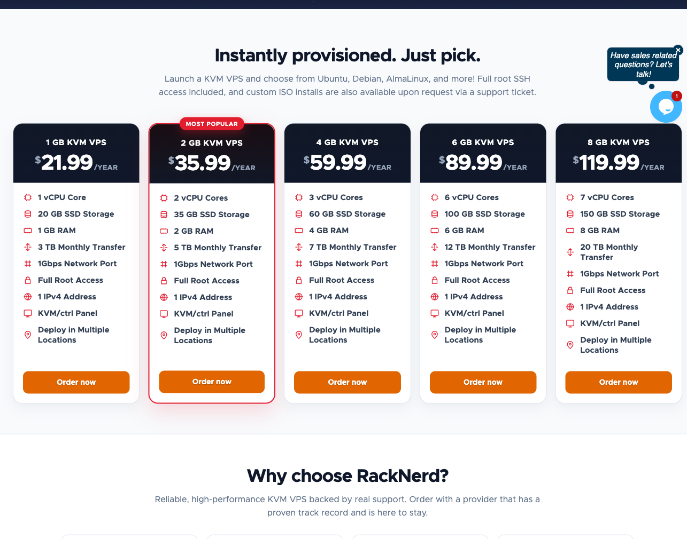
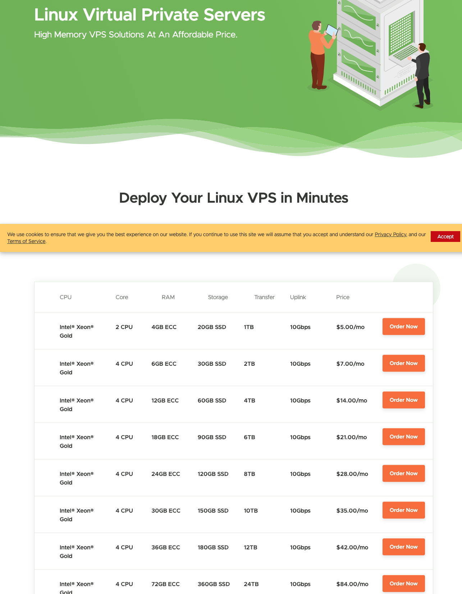
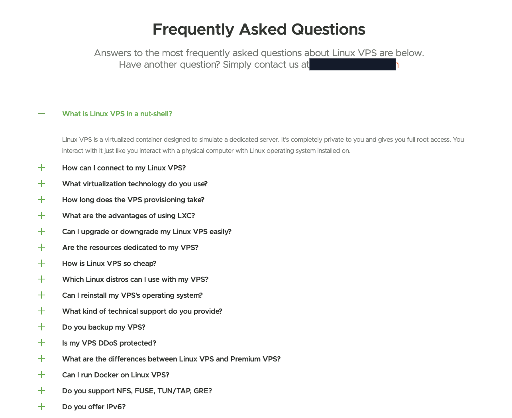
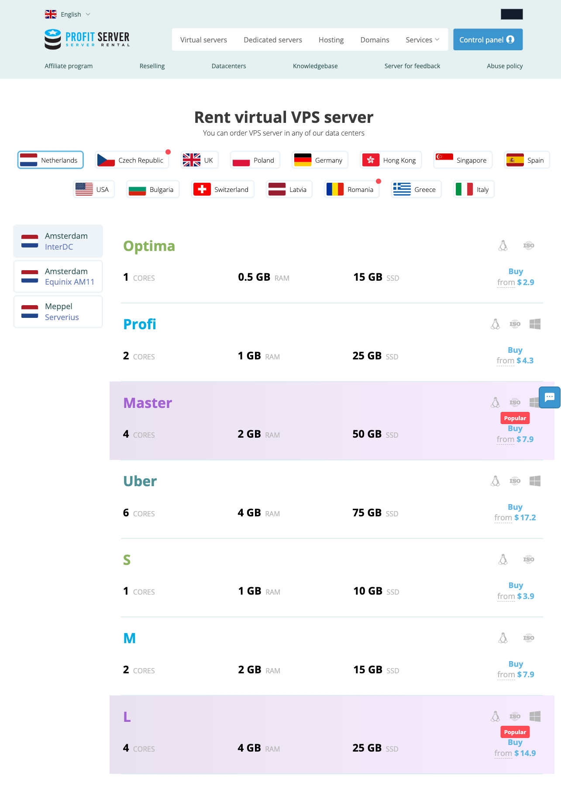
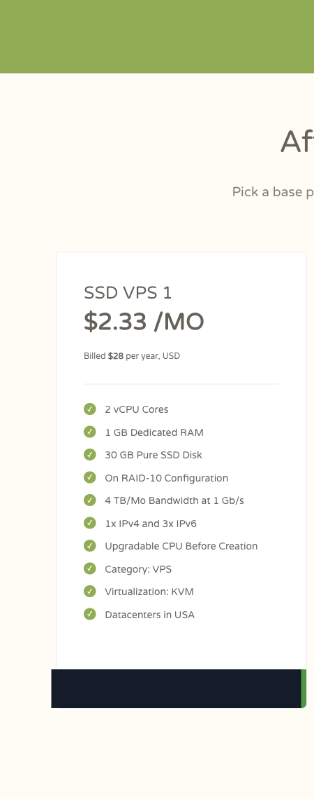

# DigitalOcean, Vultr & Hetzner Alternatives for Small VPS Projects

*Research edition: 2026-11-09. Product and image snapshot: 2026-11-02.*

> This is a buying guide based on official public pages, not a hands-on performance ranking. We did not purchase or benchmark these services, test routing or inventory, test long-term stability, attempt disaster recovery, or open support tickets. We also did not verify renewal or refund terms through purchase. Price, stock, renewal, tax, routing, policy and checkout eligibility can change; verify the exact order before paying.
>
> **Affiliate disclosure:** We may earn a commission or account credit if you buy through our RackNerd, VPSDime, ProfitServer or CloudCone links.

## Short verdict

For a small VPS project, start with the constraint that matters most:

1. **RackNerd** for a rebuildable task that should stay online and where a low annual holding cost matters more than month-to-month flexibility.
2. **VPSDime** for a RAM-forward Linux workload that benefits from monthly billing—after checking that the Linux product's virtualization and software compatibility fit the job.
3. **ProfitServer** for a location-specific worker—only after checking the live plan, billing period, policy and total at checkout.
4. **CloudCone** for a small US-based task that fits the annual **SSD VPS 1** offer shown at **$28/year** in the 2026-11-02 official snapshot. The displayed **$2.33 equivalent** is the annual price divided across 12 months, not monthly billing.

Need cloud APIs, adjacent services or repeatable provisioning? See the platform trade-offs below.

## Billing and workload comparison

This is a payment/resources/use comparison, **not a normalized performance table**. CPU labels, virtualization, storage, transfer, network paths and support boundaries differ, and none of the rows below is a benchmark result.

| Provider | Payment evidence in this edition | Resource example from the 2026-11-02 official snapshot | Best considered for | Verify before buying |
|---|---|---|---|---|
| **RackNerd** | Annual: **$21.99/year** for the displayed 1 GB special | 1 vCPU, 1 GB RAM, 20 GB SSD, 3 TB monthly transfer | Rebuildable, continuously running light tasks where low annual holding cost is useful | Live stock and location, renewal, tax, route, contention, backup, refund and management responsibility |
| **VPSDime** | Monthly: Linux **4 GB $5/month**; **6 GB $7/month** | 4 GB/2 CPU/20 GB SSD/1 TB; 6 GB/4 CPU/30 GB SSD/2 TB in the captured table | RAM-forward Linux labs and small self-hosted apps | Linux product compatibility, CPU sharing, storage behavior, transfer, backup, location, tax, renewal and support scope |
| **ProfitServer** | **Billing period unknown from the captured evidence**; several “from” figures were displayed | Location-specific cards list CPU, RAM and SSD examples | A small worker that needs one of the offered regions | Exact plan and period, live total, region, stock, tax, renewal, network policy, refund and support scope |
| **CloudCone** | Annual: **$28/year** for the displayed SSD VPS 1; **$2.33 annual-price equivalent**, not monthly billing | 2 vCPU, 1 GB dedicated RAM, 30 GB pure SSD, 4 TB monthly bandwidth, one IPv4 and three IPv6 | A small US-based service with a known annual lifespan | Current offer and total, location, availability, renewal, tax, route, recovery options, cancellation and support scope |

The smallest displayed number does not settle the choice. RackNerd's and CloudCone's annual payments are not monthly cancellation flexibility; VPSDime's memory allocation is not a CPU or storage result; and ProfitServer's “from” figures are not monthly prices unless the live order flow explicitly says so.

## 1. RackNerd: low annual holding cost for a rebuildable task

RackNerd is the clearest first path when a small bot, dashboard, personal service or worker can be rebuilt and the selected location works for its users. The official specials page captured on 2026-11-02 showed KVM plans billed per year, including a 1 GB example at $21.99/year. That supports a **low annual holding-cost** case; it does not prove RackNerd is the cheapest first trial, fastest server, or best-routed network.

*Image evidence — RackNerd official specials-page snapshot, 2026-11-02. The crop shows annual plan cards and listed resources. It is not live-inventory evidence and not an independent benchmark; confirm current stock, location, renewal, tax and checkout terms.*

### Where it fits

- A light service that should remain online for a year.
- A disposable environment whose data and configuration are backed up elsewhere.
- A buyer comfortable administering Linux and paying the full annual term up front.

### Where it loses

- A one-month experiment where easy cancellation matters more than annual holding cost.
- A workload that needs documented dedicated CPU behavior, managed backups or an advanced cloud API.
- A project whose latency or route requires a location that is unavailable for the selected special.

### Before purchase

Check the exact location and stock, renewal amount, tax, refund rules, CPU policy, transfer and port details, backup/restore path, DDoS terms and support boundary. Treat every server as self-managed unless the live order states otherwise; keep reproducible deployment instructions and off-server backups.

**Primary action:** [Compare current RackNerd specials](https://my.racknerd.com/aff.php?aff=21833)

## 2. VPSDime: monthly, RAM-forward Linux plans with a product boundary

VPSDime is the second path when memory is the binding constraint and monthly billing is preferable to paying for a year. Its Linux VPS table captured on 2026-11-02 displayed 4 GB at $5/month and 6 GB at $7/month. Those are useful resource-and-payment facts, but they do not establish application performance, dedicated CPU time, disk latency or long-term stability.

*Image evidence — VPSDime official Linux VPS product-page snapshot, 2026-11-02. The crop shows displayed monthly plans and resources. It is not live-inventory evidence and not an independent benchmark; verify the current plan, location, renewal, tax and order total.*

### The compatibility check matters

The Linux line has its own product and compatibility questions. Do not assume that a large RAM number means the same virtualization boundary, kernel behavior or software support as VPSDime's Premium product—or as a KVM cloud instance elsewhere. Confirm the requirements of Docker, custom kernels, FUSE, TUN/TAP, NFS and any other kernel-dependent software before buying.

*Image evidence — VPSDime official Linux VPS product-page FAQ snapshot, 2026-11-02. The crop documents the decision questions buyers should resolve; collapsed questions are not answers. It is not live-inventory evidence and not an independent benchmark.*

### Where it fits

- A memory-bound development lab or non-critical self-hosted app.
- A buyer who values monthly commitment over the lowest annualized invoice.
- Software whose operating-system and virtualization requirements have been checked against the exact Linux product.

### Where it loses

- A workload needing dedicated CPU guarantees or independently measured storage latency.
- Software that requires a feature the Linux product does not support.
- A buyer who needs a broad cloud-service ecosystem, standardized fleet automation or a different region.

### Before purchase

Verify virtualization and kernel compatibility, CPU sharing, storage behavior, transfer and port policy, location, backup add-on and retention, refund and cancellation rules, tax, renewal, route and support scope. A backup feature on a product page is not evidence that restores were tested.

**Primary action:** [Compare current VPSDime Linux plans](https://vpsdime.com/a/4857/linux-vps)

## 3. ProfitServer: a location-specific candidate, not a price-period claim

ProfitServer is the third path when one of its listed regions is the real requirement. The official homepage captured on 2026-11-02 showed locations across Europe, Asia and the United States alongside resource cards and “from” prices. The screenshot did **not** establish the billing period, so this guide does not call those figures monthly prices or monthly flexibility.

*Image evidence — ProfitServer official homepage snapshot, 2026-11-02. The crop shows listed regions and example plan cards, but it does not establish a billing period. It is not live-inventory evidence and not an independent benchmark; verify availability, period, currency, tax and checkout total.*

### Where it fits

- A small regional worker where a particular available location matters.
- A buyer willing to validate the exact plan and period in the current order flow.
- A self-managed, replaceable service whose route and policy can be checked before migration.

### Where it loses

- A buyer who needs a price and term that can be confirmed before entering checkout.
- A project expecting identical capacity, routing or terms across all listed regions.
- A team that needs a mature infrastructure-as-code ecosystem or a managed service boundary.

### Before purchase

Select the exact country and datacenter first, then confirm plan resources, billing period, total, currency, tax, renewal, inventory, route/looking-glass result, channel and traffic terms, prohibited-use policy, refund/cancellation terms, backup options and support scope. Do not infer that a “from” figure applies to every region or period.

**Primary action:** [Check current ProfitServer locations and plans](https://profitserver.net/?partner_id=3430198)

## 4. CloudCone: a $28 annual SSD VPS offer, not an SC2 claim

CloudCone is the fourth primary path for a small US-based service with a known annual lifespan. The official VPS page captured on 2026-11-02 displayed **SSD VPS 1 at $28 billed per year**. It also displayed a **$2.33 annual-price equivalent**—the annual price divided across 12 months. This guide does **not** describe the offer as monthly billing.

The same card displayed 2 vCPU, 1 GB dedicated RAM, 30 GB pure SSD, 4 TB monthly bandwidth, one IPv4 and three IPv6, KVM virtualization, and US datacenters. These are page specifications, not results from our own server, network or checkout tests.

*Image evidence — CloudCone official VPS-page snapshot, 2026-11-02. The pixel-preserving crop shows the SSD VPS 1 card, including its billed-per-year amount and listed resources. It is not live-stock evidence and not an independent benchmark; verify the current offer and order total.*

### Keep SSD VPS and SC2 separate

The captured VPS page points to **SC2 as a separate product line**. Nothing in this guide assigns SC2 pricing, billing, controls, backups, snapshots, APIs or other features to SSD VPS 1. If an SC2 feature is the reason to buy, evaluate that SC2 product on its own current page and terms rather than extrapolating from either line.

### Where it fits

- A small US-based service with a known annual lifespan and requirements that fit the displayed SSD VPS 1 resources.
- A rebuildable worker, lab or personal service where paying the full annual charge is acceptable.
- A buyer who can verify the current offer and maintain off-server copies before committing.

### Where it loses

- A one-month experiment that requires true monthly billing or easy month-to-month cancellation.
- A workload that depends on an SC2-specific feature not established for SSD VPS 1.
- A project that needs measured routing, latency, storage behavior, uptime or support performance before purchase.

### Before purchase

Verify that SSD VPS 1 is currently offered, the full amount and period shown at checkout, location, allocation, tax, renewal, recovery options, cancellation and refund terms, route and support scope. The 2026-11-02 screenshot does not prove current inventory or any checkout-only term.

**Primary action:** [Check the current CloudCone offer](https://app.cloudcone.com/?ref=14824)

## Additional option: GreenCloudVPS for exact KVM offer shopping

GreenCloudVPS can be considered when you are willing to compare a specific live Budget KVM SKU by CPU, RAM, storage, bandwidth, location and sale terms. It is not one of this guide's four primary paths because inventory-driven offers can vary, and the captured material did not provide enough stable evidence for a normalized price comparison.

Its weakness is repeatability: a useful configuration in one location may be unavailable later or differ from another sale item. Before buying, verify the live invoice, renewal, stock, location, CPU/storage model, route, tax, refund eligibility, traffic policy, backup retention and management responsibility.

**Ordinary official link:** [Inspect the current GreenCloudVPS Budget KVM catalog](https://greencloudvps.com/billing/store/budget-kvm-sale)

## Platform trade-offs: DigitalOcean vs Vultr vs Hetzner

These three platforms are comparison points, not the primary purchase paths in this guide. Use ordinary official links to examine the platform advantage you would actually consume:

- **[DigitalOcean Droplets](https://www.digitalocean.com/pricing/droplets):** worth considering when documentation, a familiar developer experience and adjacent platform services reduce operating work. The trade-off is paying for an ecosystem a single light VM may not need, plus checking the full stack cost rather than a headline starting price.
- **[Vultr Cloud Compute](https://www.vultr.com/products/cloud-compute/):** worth considering when deployment-location breadth and cloud-style provisioning are requirements. Check the exact region, RAM, storage, IP and retained-resource charges instead of treating the smallest advertised tier as equivalent to every budget VPS.
- **[Hetzner Cloud](https://www.hetzner.com/cloud):** worth considering when its regions, account model and tooling fit the project. Check tax, account acceptance, routing and separately billed items such as primary IPv4; a strong value reputation does not make it universal.

Choose one of these platforms when you can name the documentation, API, service, location or operational benefit that justifies it. Otherwise, a smaller provider whose billing and resource shape matches the workload may be the more focused experiment.

## Pre-purchase checks that can reverse the verdict

1. **Billing:** exact amount, currency, billing period, renewal, setup fees, tax and refund/cancellation rules.
2. **Resources:** virtualization, shared or dedicated CPU behavior, RAM, storage type/size, transfer and port policy.
3. **Location:** datacenter—not merely company country—plus route or looking-glass evidence for your users.
4. **Availability:** live stock and whether the displayed configuration is actually selectable.
5. **Recovery:** backup control, retention, restore process, snapshots, rescue console and exportability.
6. **Network:** DDoS boundary, IPv4/IPv6, traffic restrictions and any location-specific channel limits.
7. **Operations:** root access, image choices, reinstall, lifecycle, deletion timing and support responsibility.
8. **Policy:** acceptable use and software/workload restrictions for the exact product.
9. **Exit:** reproducible provisioning and off-server copies so a failed experiment stays reversible.

## Final buying order

- **RackNerd:** start here for a rebuildable task where the low annual holding cost and an available location fit. [Compare current specials](https://my.racknerd.com/aff.php?aff=21833).
- **VPSDime:** start here for monthly, RAM-forward Linux hosting after the compatibility check. [Compare current Linux plans](https://vpsdime.com/a/4857/linux-vps).
- **ProfitServer:** inspect this when a specific listed region matters, then verify the plan and billing period before paying. [Check current locations and plans](https://profitserver.net/?partner_id=3430198).
- **CloudCone:** inspect this for a small US-based task that fits the displayed annual SSD VPS 1 shape; treat $2.33 as an annual-price equivalent, not monthly billing. [Check the current offer](https://app.cloudcone.com/?ref=14824).

No provider above is declared fastest, most reliable or best-routed. The defensible choice is the smallest reversible purchase that meets the written workload, location and payment requirements.

## Sources and limits

Official pages used in this edition:

- [RackNerd VPS specials](https://www.racknerd.com/specials)
- [VPSDime Linux VPS](https://vpsdime.com/linux-vps)
- [ProfitServer VPS catalog](https://profitserver.net/)
- [CloudCone SSD VPS catalog](https://cloudcone.com/vps/)
- [GreenCloudVPS Budget KVM catalog](https://greencloudvps.com/billing/store/budget-kvm-sale)
- [DigitalOcean Droplet pricing](https://www.digitalocean.com/pricing/droplets)
- [Vultr Cloud Compute](https://www.vultr.com/products/cloud-compute/)
- [Hetzner Cloud](https://www.hetzner.com/cloud) and [billing overview](https://docs.hetzner.com/cloud/billing/faq)

Public pages and full-page snapshots can omit dynamic selectors, live inventory and checkout-only terms. No checkout was completed. We did not independently test CPU, disk, application throughput, network routes, uptime, restoration, long-term stability or support response. Recheck all material facts at purchase time.
