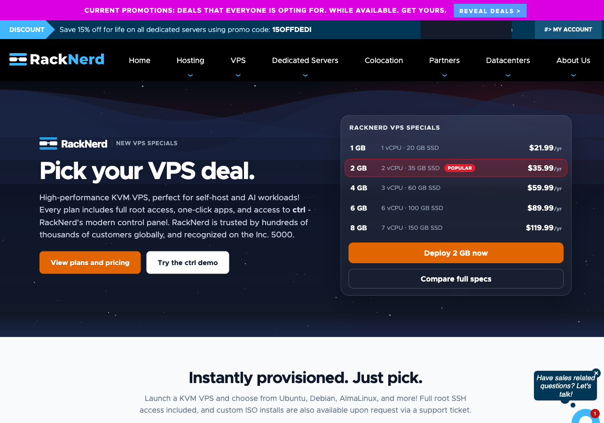
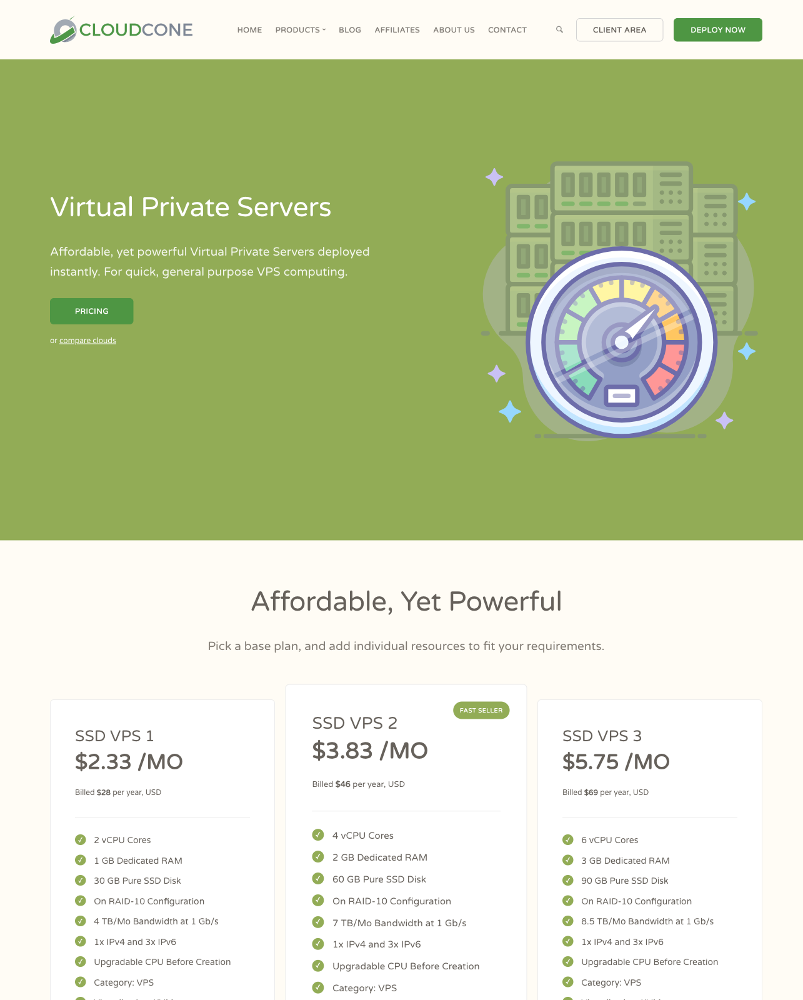
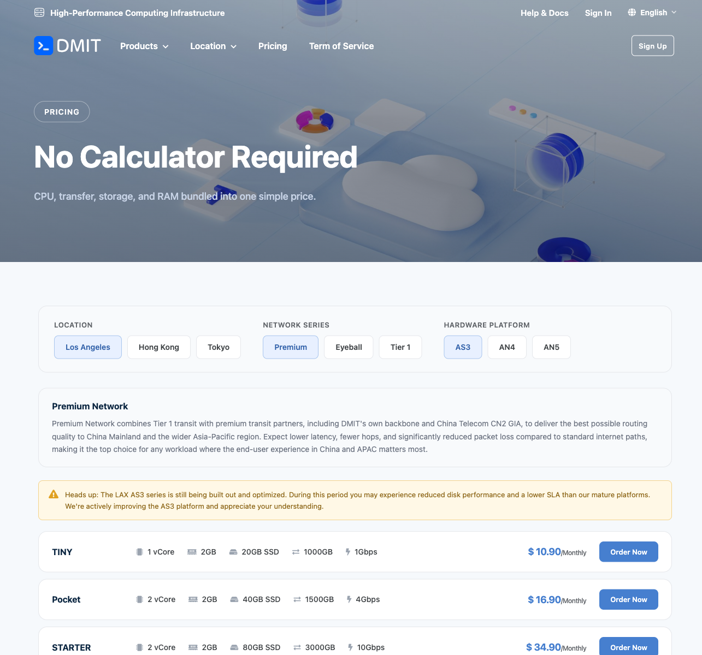
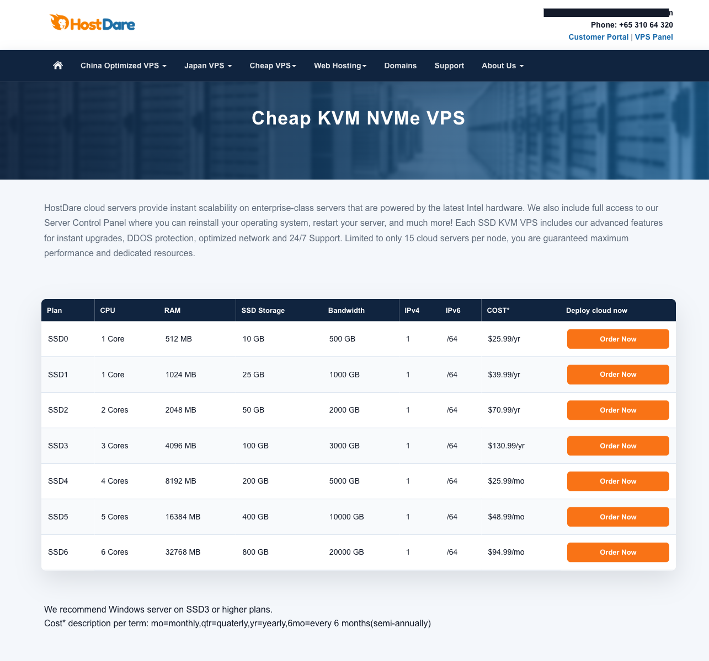
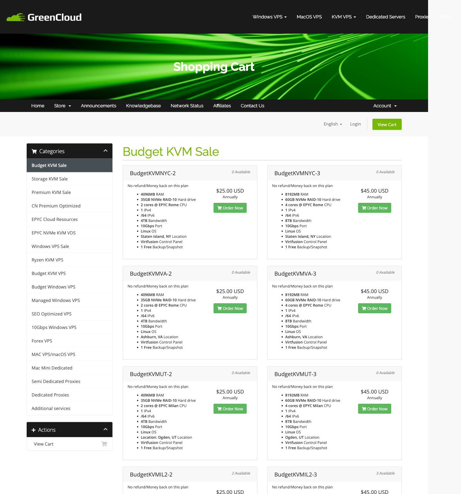
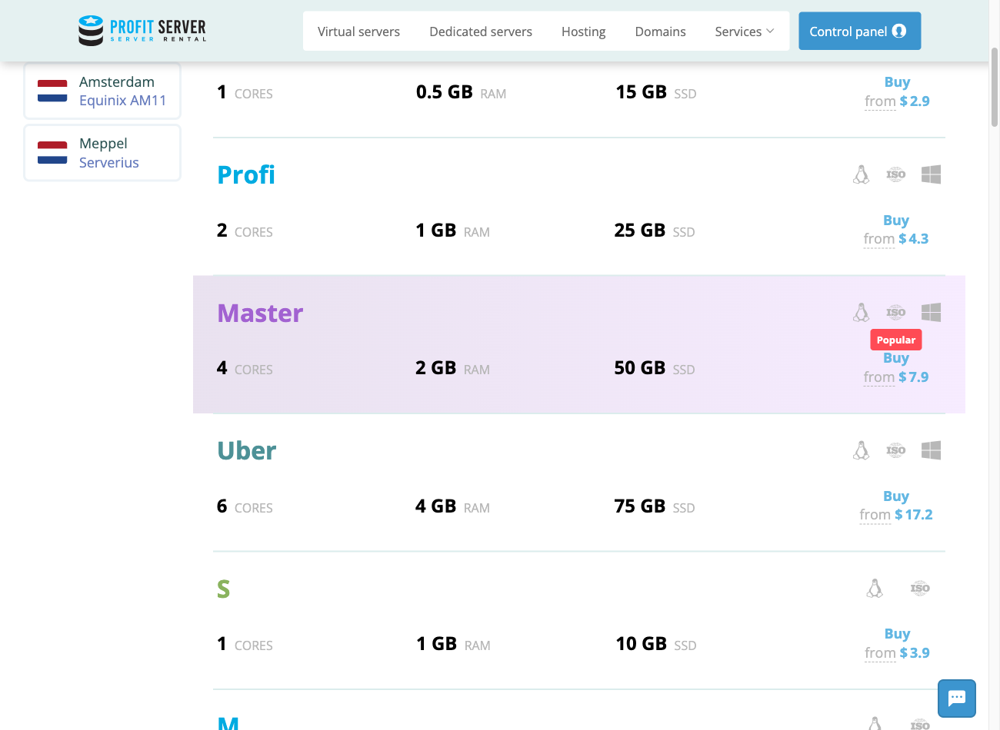

# Cheap VPS by Workload: Eight Hosts, and When a Managed Platform Makes More Sense

> **Updated: 2026-11-04 (affiliate status) · Public-price verification: 2026-11-02 · Currency: USD**  
> This is a selection guide based on public product pages, not a hands-on performance ranking. No server was purchased or benchmarked for this guide. Listed prices do not establish stock, checkout eligibility, renewal cost or taxes.

> **Link disclosure:** The **RackNerd** link marked below is our own affiliate link — it was supplied and confirmed as ours by the site owner, and signing up through it may earn us a commission or account credit under RackNerd's rules, at no extra cost to you. ⚠️ We did **not** log in to RackNerd's back office to activate or verify that link ourselves, so its commission rate, settlement and payout terms are whatever the provider's own dashboard and contract say — this guide claims none of them. **Every other provider link below is an ordinary official link, and we use nobody else's referral code.** Commercial relationships must not change the comparison, limitations or inclusion of alternatives.

## The short verdict

**Buy a cheap VPS when you want control and can accept responsibility for the operating system. Buy a managed service when the work you need to outsource matters more than the VM's sticker price.**

- **Hobby projects:** start by comparing RackNerd's annual specials, CloudCone's annual SSD VPS and VPSDime's monthly Linux plans. A low invoice is useful only if the selected region and resources fit your application.
- **Production:** none of these eight earns a blanket recommendation from untested specifications. Choose an exact product, recovery plan and support arrangement—not a brand nickname.
- **Databases:** more RAM is not proof of durable storage or predictable write latency. VPSDime and selected GreenCloud offers are candidates to investigate; a managed database may be the better answer for critical data.
- **Automation:** an always-on SSH worker and an API-provisioned fleet are different purchases. Confirm lifecycle APIs and infrastructure-as-code support before committing to the latter.
- **Regional networking:** investigate BandwagonHost, DMIT or HostDare's specific optimized products only if that routing serves your users. Do not pay a route premium merely because a guide calls it “better.”

The numbered cards below are a reading order, not a performance leaderboard.

<!-- IMG:VPS-EN-workload-decision | Optional original decision diagram; explanatory only, not a benchmark. No image asset supplied. -->

## What a cheap VPS price leaves out

### Shared resources are not automatically a bad deal

A vCPU is a scheduling allocation, not necessarily an exclusively assigned physical core. KVM provides virtualization and isolation; it does not, by itself, prove dedicated CPU time. A generous RAM allocation can coexist with shared CPU, storage and network contention.

Overselling means selling allocations beyond immediately available capacity. It is distinct from ordinary resource sharing. This guide has not measured host contention at any provider, so it does not label a provider oversold—or certify a “no overselling” slogan.

For a bursty personal site, shared resources may be entirely reasonable. For a sustained build worker or write-heavy database, investigate CPU-use limits, storage latency and behavior under your actual workload. An NVMe label alone cannot answer those questions.

### “Unmetered” and “10Gbps” answer different questions

Unmetered usually concerns traffic volume. Port speed concerns a link's capacity. Neither establishes your sustained application throughput, fair-use allowance or freedom from congestion.

A server near your users may reduce distance, but geography does not establish a good network path. A China-optimized route is a product-specific attribute, not a global performance upgrade. Compare the traffic direction and audience you actually serve.

### The invoice is only part of the operating cost

Check these before normalizing prices:

| Cost or constraint | What to establish before buying |
|---|---|
| Billing commitment | The amount due now, service term, renewal amount and cancellation rules. A monthly-equivalent annual price is not monthly billing. |
| IPv4 and licenses | Included addresses, extra-address charges, Windows licensing and optional hosting panels. |
| Transfer | Whether allowances count inbound, outbound or both; overage, throttling and suspension behavior. |
| Backups | Price, retention, location, exportability and restore procedure. RAID and a snapshot on the same failure domain are not independent backups. |
| Operations | OS updates, firewall rules, secrets, monitoring and application support: who owns each task? |
| Recovery and SLA | What failures are covered, how credits are claimed and how quickly you can restore. A credit policy is not compensation for all business losses. |

A useful comparison is:

```text
Operating cost = VM invoice + backup storage + optional IPs/licenses/transfer
               + monitoring and administration + incident recovery work
```

Compare these costs over the same service term. Stopping a VM also does not necessarily stop billing; check retained disks, reserved IPs and the provider's deletion rules.

## Choose the service model for your workload

### Hobby: optimize for a reversible mistake

A personal dashboard, development sandbox or small scheduled worker is a good place to learn server administration. The important question is whether you can rebuild it from code and recover anything valuable from elsewhere.

RackNerd's **$21.99/year** special and CloudCone's **$28/year** SSD VPS give a low annual invoice. VPSDime's **$5/month** Linux plan offers a different trade-off: a higher twelve-month cash total, but less initial commitment. These are different resource bundles, not interchangeable machines.

**Who should not use the cheapest annual plan:** someone who needs hands-on application management, expects a refund on every promotional SKU, or cannot lose access while rebuilding. If you only need to publish static files, static hosting may remove server maintenance altogether.

### Production: select recovery and support before extra cores

A production VPS can be sensible when the team knows how to patch it, monitor it and restore it. “Unmanaged” does not mean inherently unreliable; it means responsibilities must be assigned explicitly.

BandwagonHost's listed backup and snapshot features warrant inspection. DMIT offers distinct network and hardware series. Neither feature set replaces an application recovery plan. A second VM on the same host or in the same account is not automatically meaningful failover.

A cloud VM is not a managed application platform merely because it has an API. Conversely, an app platform's deploy workflow does not necessarily include managed database recovery. Compare the exact service: deployment, OS maintenance, database backups, observability, support and failure handling.

**Who should not use this bare-VM shortlist as a final answer:** a team that needs someone else to own application incidents, or a service whose availability requirements cannot be met by its proposed recovery design. A managed host or platform may be worth the larger invoice.

### Database: buy a recovery design, not a RAM bargain

Memory-rich VPSDime plans and individual GreenCloud KVM offers are worth investigating for development databases or non-critical self-hosting. They are not verified database winners.

For important data, define the acceptable data-loss window and restore time. Check storage limits, backup consistency, off-host copies, point-in-time recovery where needed, and an actual restore rehearsal. A disk benchmark cannot prove durability; a provider backup label cannot prove an application-consistent restore.

**Who should not self-manage this database:** someone who cannot maintain, protect and restore it, or who expects a single cheap VM to deliver high availability. Compare managed database products on the responsibilities they remove, not only on RAM per dollar.

### Automation: separate job execution from provisioning

For a persistent scheduler, bot or worker, SSH access and a suitable OS may be enough. RackNerd, CloudCone, VPSDime and ProfitServer offer product lines to investigate for this pattern. Resource and acceptable-use policies still apply.

For disposable CI machines or multi-region infrastructure, verify more:

- Documented create/delete/rebuild APIs for the exact product line;
- Supported Terraform integration—or a maintainable alternative—not just a control-panel button;
- Image IDs, regional inventory, quotas, credential scope and rate limits;
- Billing granularity and what remains chargeable after a job ends;
- An idempotent recovery path when provisioning fails halfway through.

This pass did **not** verify an end-to-end provisioning API or Terraform workflow for any of the eight providers. That means **unverified**, not “no API.” If lifecycle automation is mandatory, resolve it before buying an annual special; a developer-oriented cloud platform may be a better fit.

## Dated price and product snapshot

**All rows were checked against public-page text on 2026-11-02.** Resources and policies are provider statements. Prices are listed examples, not independently confirmed purchasable inventory. Unknowns are not filled with historical promotion prices.

| Provider and exact example | Listed resources | Displayed base price | Important unresolved condition |
|---|---|---:|---|
| RackNerd · 1 GB KVM special | 1 vCPU, 1 GB RAM, 20 GB SSD, 3 TB monthly transfer, one IPv4 | **$21.99/year** | Location stock, renewal and refund terms for the chosen order |
| BandwagonHost · 40G KVM PROMO | 3 listed CPU allocations, 2 GB RAM, 40 GB SSD, 2 TB/month | **$99.99/year** | Listing does not establish stock or optimized routing |
| CloudCone · SSD VPS 1 | 2 vCPUs, 1 GB RAM, 30 GB SSD, 4 TB/month, one IPv4 | **$28/year**, advertised $2.33/month equivalent | Annual VPS features must not be inferred from SC2 marketing |
| DMIT · LAX.AS3.T1 WEE | 1 vCore, 1 GB RAM, 20 GB SSD, 1,000 GB “Max (IN, OUT)” | **$36.90/year** | Explicit AS3 disk-performance/lower-SLA warning; not a mature-platform equivalent |
| HostDare · SSD0 | 1 core, 512 MB RAM, 10 GB SSD, 500 GB transfer, one IPv4 | **$25.99/year** | Actual hardware/storage and restrictive refund conditions |
| GreenCloudVPS · BudgetKVMNYC-2 | 2 EPYC Rome cores, 4,096 MB RAM, 35 GB NVMe, 4 TB bandwidth | **Not verified** | Extract exposed specifications and stock, but no usable price; sale marked non-refundable |
| VPSDime · Linux 4 GB | 2 listed CPUs, 4 GB RAM, 20 GB SSD, 1 TB transfer | **$5/month** | Linux virtualization differs from Premium KVM; nightly backups are an add-on |
| ProfitServer · Optima / S examples | Optima: 0.5 GB RAM, 15 GB SSD; S: 1 GB RAM, 10 GB SSD | **$2.90 / $3.90 displayed** | Billing-cycle label and exact region pairing not recovered; do not treat these as verified monthly invoices |

For transparent arithmetic, $21.99 divided by 12 is approximately **$1.83/month**, and $25.99 divided by 12 is approximately **$2.17/month**. Both remain annual purchases. Do not mix them with monthly cancellation flexibility or a differently specified VM.

## Eight provider cards

### 1. RackNerd — a low annual invoice for rebuildable projects



**Fit:** Linux learning, a lightweight persistent worker, development services and personal projects you can restore independently.

The [specials page](https://www.racknerd.com/specials) listed the 1 GB KVM plan at **$21.99/year** on 2026-11-02. Its ctrl panel is described as offering reinstall, console, firewall and one-click applications. Those can reduce setup work; they do not establish managed application support or lifecycle API compatibility.

**Who should NOT use it:** a buyer choosing solely by annual price while requiring predictable sustained CPU, a verified regional route or someone to maintain the application.

**Before committing:** check the selected region, resource-use policy, backup provisions, renewal price and cancellation/refund terms. No independent uptime, throughput or CPU result is available in this guide.

<!-- AFF_SLOT:RACKNERD | Filled 2026-11-04: affiliate URL supplied and confirmed as ours by the site owner. Not activated or verified by us; commission rate and payout terms not verified. -->
**Plans · our affiliate link:** [Compare RackNerd specials through our affiliate link](https://my.racknerd.com/aff.php?aff=21833).

### 2. BandwagonHost — inspect the operational features and the route separately


**Fit:** self-managing users who value the listed KiwiVM recovery/migration features, or who have identified a specific network product worth its premium.

The [public catalog](https://bandwagonhost.com/cart.php?gid=1) listed **40G KVM PROMO at $99.99/year** on 2026-11-02, with automatic backups, snapshots, migration and a stated 99.95% uptime guarantee. These are provider claims; backup retention, covered failures and product-specific migration choices still need verification.

**Who should NOT use it:** someone assuming every BandwagonHost SKU has the same premium route, or treating a listed promotional plan as guaranteed available inventory.

**Before committing:** identify the region and network series on the actual order. The catalog explicitly calls the service **strictly self-managed**. Backups and an uptime guarantee do not change that responsibility split.

<!-- AFF_SLOT:BANDWAGONHOST | No submission recorded in supplied status ledger; no affiliate URL supplied. -->
**Official catalog · affiliate slot unfilled:** [Inspect BandwagonHost products](https://bandwagonhost.com/cart.php?gid=1).

### 3. CloudCone — an annual VPS is not its entire cloud platform



**Fit:** a small US-based service with a known annual lifespan and a workload that fits the chosen SSD VPS.

The [SSD VPS page](https://cloudcone.com/vps) showed **$28/year** for SSD VPS 1 on 2026-11-02. It separately points readers to SC2 for more features. Parts of the page also discuss SC2, so it would be unsafe to assign every cloud feature to the annual VPS.

**Who should NOT use it:** someone buying the annual plan while expecting unverified SC2 billing, backups or API behavior; someone requiring a network path not established for the chosen SKU.

**Before committing:** get product-specific answers about recovery, snapshots, traffic and cancellation. Root access and a dashboard are useful, but are not proof of a managed service.

<!-- AFF_SLOT:CLOUDCONE | Existing owner account; authorized code retrieval outstanding. No affiliate URL supplied. -->
**Official plans · affiliate slot unfilled:** [Compare CloudCone SSD VPS](https://cloudcone.com/vps).

### 4. DMIT — the hardware and network series matter more than the lowest price



**Fit:** applications whose audience justifies a particular regional network, or buyers deliberately comparing DMIT's different hardware and transfer bundles.

The [pricing page](https://www.dmit.io/pages/pricing) showed **LAX.AS3.T1 WEE at $36.90/year** on 2026-11-02. It also listed **LAX.AN5.T1 VOLUME V2C2G at $14.90/month**, with 2 GB RAM and 40 GB SSD. These are different products, not two billing choices for the same machine.

**Who should NOT use it:** someone calling the cheapest AS3 plan a production bargain while ignoring the provider's warning about reduced disk performance and a lower SLA. HKG Eyeball was also explicitly described as beta and not recommended for high-stability production use.

**Before committing:** bind every claim to location, hardware and network series. Tier 1 is not Premium. The page itself says listed products/prices may lag adjustments; no current stock or routing result was independently verified here.

<!-- AFF_SLOT:DMIT | No submission recorded in supplied status ledger; no affiliate URL supplied. -->
**Official pricing · affiliate slot unfilled:** [Inspect DMIT series and warnings](https://www.dmit.io/pages/pricing).

### 5. HostDare — read the small-plan limits before the headline



**Fit:** a small, self-managed workload that fits a particular HostDare product; a buyer who can distinguish its ordinary and optimized network offerings.

The [SSD VPS page](https://www.hostdare.com/vps.html) listed **SSD0 at $25.99/year** on 2026-11-02. The page title says NVMe, while the table uses SSD and a hardware section references Ivy/Sandy Bridge processors. Confirm the ordered hardware instead of declaring the whole line modern or fast from the headline.

**Who should NOT use it:** someone expecting the lowest ordinary-plan price to buy a premium network, or relying on a broad, unconditional refund trial.

**Before committing:** the page describes a **three-day, conditional refund**, possible $0.50–$1 deductions and possible refusal after using at least 20% of the monthly bandwidth. It also says Windows licenses are not included. Those details can matter more than the annual-price difference.

<!-- AFF_SLOT:HOSTDARE | No submission recorded; public affiliate research identifies an active-service prerequisite. No purchase or affiliate URL supplied. -->
**Official plans · affiliate slot unfilled:** [Check HostDare specifications and refund terms](https://www.hostdare.com/vps.html).

### 6. GreenCloudVPS — compare one inventory-backed offer at a time



**Fit:** experienced buyers willing to select an exact CPU/storage/location bundle and accept the particular sale conditions.

The [Budget KVM sale catalog](https://greencloudvps.com/billing/store/budget-kvm-sale) exposed configurations, mixed stock levels and a “No refund/Money back” label on 2026-11-02. It did **not** expose a usable price in this capture. There is no verified current starting price in this edition.

**Who should NOT use it:** someone who needs a permanently available identical SKU, assumes all locations use the same hardware, or treats a non-refundable sale as a refundable performance trial.

**Before committing:** verify the live invoice, renewal, exact CPU/storage, resource policy and backup retention. “1 Free Backup/Snapshot” is not enough information to establish an off-host recovery plan. No database-performance recommendation is justified without testing the chosen product.

<!-- AFF_SLOT:GREENCLOUD | No submission recorded in supplied status ledger; no affiliate URL supplied. -->
**Official sale catalog · affiliate slot unfilled:** [Inspect GreenCloud's exact offers](https://greencloudvps.com/billing/store/budget-kvm-sale).

### 7. VPSDime — useful monthly RAM options, with product-line boundaries


**Fit:** memory-heavy development tools, a persistent automation worker or a non-critical self-hosted service whose owner wants monthly billing.

The [Linux plan table](https://vpsdime.com/linux-vps) listed **4 GB at $5/month** and **6 GB at $7/month** on 2026-11-02. The [FAQ](https://vpsdime.com/) says Linux uses its own optimized virtualization platform; Premium uses KVM and offers dedicated CPU. Do not describe the low-price Linux plan as the Premium product.

**Who should NOT use it:** someone requiring a particular kernel/isolation model without checking compatibility, or treating generous RAM as evidence of guaranteed database write performance.

**Before committing:** Linux nightly backups are an optional add-on with stated three-night retention; Premium includes nightly backups. The FAQ also describes a 72-hour first-order refund subject to TOS/AUP and suspension after exhausting transfer without adding capacity. These are public policies, not exercised guarantees.

<!-- AFF_SLOT:VPSDIME | No submission recorded in supplied status ledger; no affiliate URL supplied. -->
**Official Linux plans · affiliate slot unfilled:** [Compare VPSDime's monthly bundles](https://vpsdime.com/linux-vps).

### 8. ProfitServer — regional workers, provided the invoice and policies fit



**Fit:** separate small workers or regional services where the chosen location, network capacity and actual billing cycle meet the job.

The [public product page](https://profitserver.net/) displayed **$2.90 Optima** and **$3.90 S** examples on 2026-11-02. The flattened capture did not recover a reliable billing-cycle label or every location-to-price association. These are not certified $2.90/month or $3.90/month offers in this guide.

**Who should NOT use it:** someone equating “unlimited traffic” with gigabit throughput, or treating a multi-location catalog as proven infrastructure automation or application failover.

**Before committing:** the FAQ describes a non-guaranteed 100 Mbps channel with different minimums by location. It also says unpaid blocked VPS services are deleted after **72 hours** and that outbound port 25 is restricted in some locations. Keep off-provider backups and check mail/worker policies before deployment; do not infer anonymous purchasing from crypto support.

<!-- AFF_SLOT:PROFITSERVER | No submission recorded in supplied status ledger; no affiliate URL supplied. -->
**Official catalog · affiliate slot unfilled:** [Check ProfitServer's location-specific offers](https://profitserver.net/).

## Affiliate status: three states, not three marketing labels

The public-link policy for this edition is:

| State | Required evidence | Link shown to readers |
|---|---|---|
| **Official link only** | No authorized link supplied; an unstarted application or an existing account awaiting code retrieval belongs here | Ordinary official product URL |
| **Application pending** | A real submission receipt, with no final approval yet | Ordinary official URL; no implication of endorsement |
| **Authorized affiliate link** | Approved promotion scope and an owner-authorized URL for this publication | Clearly labeled affiliate URL after disclosure |

**Current snapshot, 2026-11-04:** **RackNerd is now an authorized affiliate link** — the URL was supplied and confirmed as ours by the site owner; we did not log in to activate it and we do not state its commission rate, cookie window or payout terms, because we have not verified them. CloudCone still has an existing owner account awaiting authorized code retrieval, and the supplied ledger records BandwagonHost, DMIT, HostDare, GreenCloud, VPSDime and ProfitServer as unstarted, so **those seven remain official link only** in this edition. Awaiting a code is not the same as an application pending approval; having a customer account is not evidence of testing or partnership approval.

## Sources and verification limits

- Product sources are linked beside each price/card: RackNerd specials, BandwagonHost catalog, CloudCone VPS, DMIT pricing, HostDare VPS, GreenCloud Budget KVM sale, VPSDime Linux/FAQ and ProfitServer catalog/FAQ.
- The RackNerd **affiliate** URL was supplied and confirmed as ours by the site owner; it was not obtained by logging in on our side, and we make no claim about the commission rate or payout terms attached to it.
- Sources were inspected as public-page text through a third-party extraction service. Extraction can omit dynamic prices and flatten location tabs. It is not a completed checkout or a pixel-verified screenshot.
- No YABS, storage latency, application throughput, long-term uptime, route or backup-restore measurements were performed. Screenshots show dated public pages, not test results. No benchmark chart is supplied. Any later chart must identify the exact VM, region, date, method and raw results.
- The $99.99 BandwagonHost and $36.90 DMIT AS3 prices are catalog observations, not confirmed stock. Historical prices were not silently relabeled as current purchasable offers.
- Recheck price, stock, renewal, taxes, refund and resource policy on the exact official order before paying. Missing evidence is a reason to verify, not a reason to invent a negative claim.

## Final verdict

For a rebuildable hobby service, compare **RackNerd and CloudCone's annual invoices with VPSDime's monthly commitment**. For a particular regional network, inspect **BandwagonHost, DMIT and HostDare at the product-series level**. For configurable inventory or regional workers, investigate **GreenCloud and ProfitServer without importing an unverified starting price**.

For production, databases and API-driven fleets, the decisive question is not “which gives the most RAM?” It is **“who owns operations, and can this exact service meet the recovery and automation requirements?”** If the answer is unclear, resolve it—or choose a managed product—before committing. That is a better VPS decision than an unsupported universal winner.
